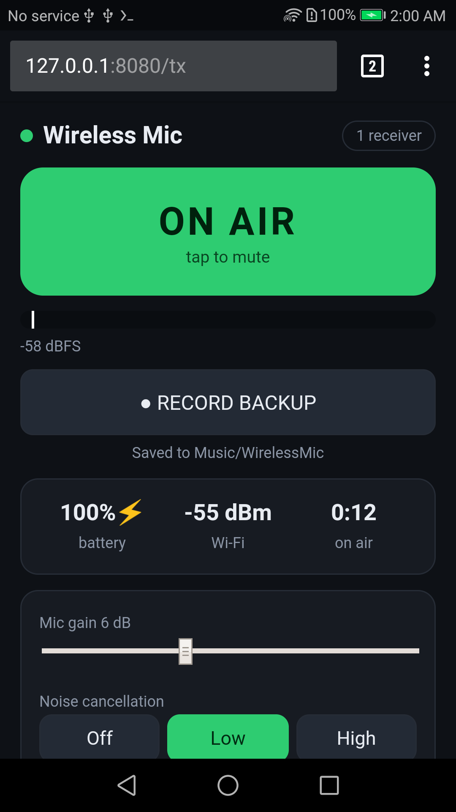
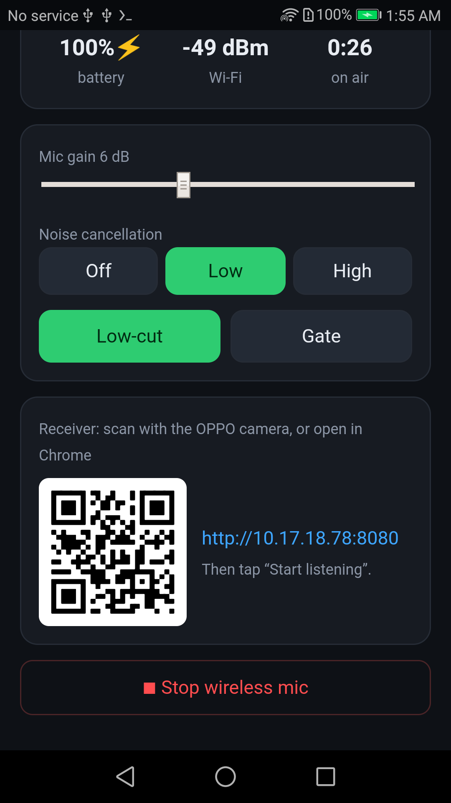

# Android Wireless Mic

Turn an old Android phone into a **Hollyland-style wireless microphone**. The phone is the
transmitter, and any browser on the same Wi-Fi is the receiver (another phone, a PC, OBS). It runs
in [Termux](https://termux.dev), with no Android SDK, no root and nothing to install on receivers.

Built and tested on a **Honor 8 (FRD-L02, Android 7.0)** with a phone hotspot as the network.

<p>
  
  
</p>

## Features

| Hollyland-style feature | This project |
|---|---|
| Wireless TX → RX | WebSocket over Wi-Fi, 10 ms audio frames, ~70–120 ms end to end (adjustable buffer 30–300 ms) |
| Noise cancellation | Spectral noise suppression (Off / Low / High) with minimum-statistics noise tracking |
| Low-cut | 80 Hz high-pass for wind and handling rumble |
| Onboard backup recording | 48 kHz / 16-bit WAV on the phone (`Music/WirelessMic/`), crash-safe header |
| Safety channel | WAV right channel = main at −6 dB, which rescues clipped takes |
| Gain / mute | From the phone or remotely from any receiver (−12…+36 dB) |
| Status | TX battery, TX Wi-Fi RSSI, level meter with peak hold and clip warning, latency, packet loss |
| Lavalier mic | Any TRRS lav mic in the 3.5 mm jack |
| Home-screen app | One-tap **Wireless Mic** / **Stop Mic** icons (Termux:Widget) |
| Easy pairing | QR code on the transmitter screen opens the receiver page |

Measured on the Honor 8: 100 packets/s with 0 lost, about 2 % CPU.

## How it works

```
Phone mic / TRRS lav ─► PulseAudio (OpenSL ES source) ─► parec 48 kHz mono
   ─► server.py: noise suppression ─► gate ─► gain ─► WAV recorder (main + safety −6 dB)
   ─► WebSocket broadcast (ws :8081, wss :8082) ─► receiver.html in any browser (Web Audio)
HTTP and HTTPS are both served on :8080 (Chrome often upgrades http:// to https://).
```

## Install (on the transmitter phone)

You need these apps, all from the same source (F-Droid or GitHub, because their signing keys must match):
**Termux**, **Termux:API**, **Termux:Widget**.

```bash
pkg install git
git clone https://github.com/partha-cybersec/android-wireless-mic
cd android-wireless-mic
bash install.sh
```

Then give **Termux:API** microphone permission, and add the **Termux shortcut** widget to the home
screen twice: once for *Wireless Mic*, once for *Stop Mic*.

## Use

1. Tap **Wireless Mic** on the home screen, or type `wmic` in Termux. The transmitter screen opens.
2. On the receiver phone, scan the QR code (or open `http://<phone-ip>:8080`) and tap **Start listening**.
   - If Chrome shows *Your connection is not private*, that's the phone's self-signed certificate:
     tap **Advanced → Proceed**.
3. **Into a camera:** receiver phone headphone jack → **TRRS-to-TRS** cable → camera MIC input.
4. **PC over USB (no Wi-Fi):** `adb forward tcp:8080 tcp:8080 && adb forward tcp:8081 tcp:8081`,
   then open `http://localhost:8080`.
5. **OBS:** add a Browser source with the receiver URL and tick *Control audio via OBS*.
6. Tap **Stop Mic** when done. A running recording is closed cleanly.

Backup recordings can be downloaded from the receiver page.

## Limitations

- Latency is about 70–150 ms (Wi-Fi + browser audio), versus about 20 ms on dedicated 2.4 GHz systems.
  That's fine for recording and vlogging; for live lip-sync, shift the audio in your editor.
- Range is Wi-Fi range. A phone hotspot or a 5 GHz router works best.
- On Huawei/EMUI, enable *Phone Manager → Protected apps → Termux* for long sessions.

## Files

| Path | Purpose |
|---|---|
| `transmitter/server.py` | Capture, DSP, recorder, HTTP/HTTPS + WebSocket server |
| `transmitter/receiver.html` | Receiver / remote-control page |
| `transmitter/tx.html` | Transmitter app screen (ON AIR, REC, meters, QR) |
| `transmitter/wmic` | Launcher: PulseAudio, mic source, certificate, wake lock |
| `shortcuts/` | Termux:Widget home-screen shortcuts and icons |
| `install.sh` | One-shot installer for Termux |

## License

MIT
